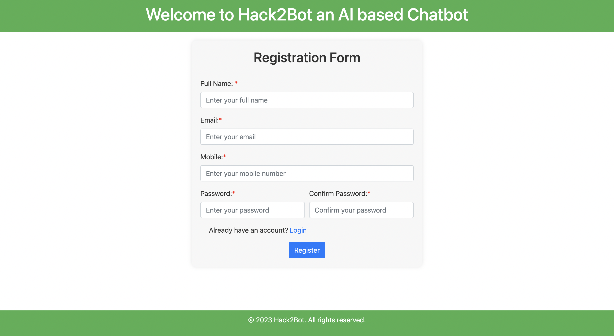
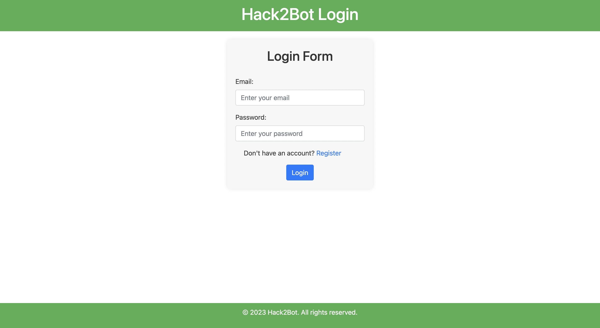
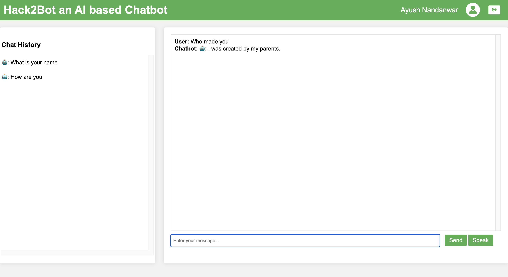

# Hack2Bot — AI Chatbot

A web-based chatbot project integrated with the OpenAI API. The application includes user registration, login, and a chat interface.

## Application preview

| Registration | Login | Chat |
|---|---|---|
|  |  |  |

## Technology

- **Runtime:** Node.js
- **Web framework:** Express
- **Database:** MongoDB with Mongoose
- **Authentication:** JWT and bcrypt
- **Templating:** EJS and Pug
- **AI integration:** OpenAI API

## Getting started

### Prerequisites

- Node.js and npm
- A MongoDB connection string
- An OpenAI API key

### Configure environment

Create a `config.env` file in the project root:

```env
DATABASEURL=<YOUR_MONGO_URL>
JWT_SECRET=<YOUR_JWT_SECRET_KEY>
API_KEY=<YOUR_OPENAI_API_KEY>
```

Keep real credentials out of source control. Use your own values and do not commit the environment file.

### Install and run

```bash
npm install
npm run start
```

The start script runs `node index.js`.

## Repository

[Browse the source code](https://github.com/ayushnandanwar/Hack2Bot-AI-Chatbot)

---

<sub>Built as a team hackathon project. The repository documents an early full-stack implementation of authentication and an AI-powered chat experience.</sub>
